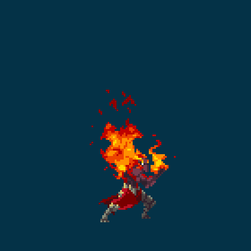
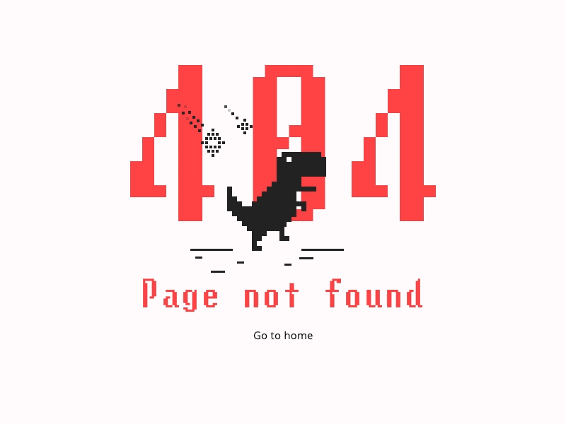
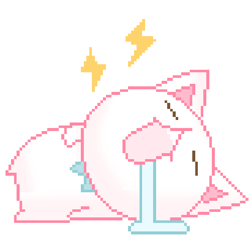
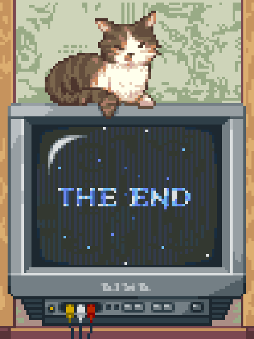

<div align="center">


# Hey, I'm Aaradhya 👋


<br>


**`▶ PLAYER 1 READY  ·  SCROLL DOWN TO PLAY`**

[](https://github.com/AARADHYA944)
[](https://www.linkedin.com/)


</div>

---

## 🕹️ LEVEL 0: Player Select

<table>
<tr>
<td width="50%" valign="top">

**Class:** Developer + Tester
**Home world:** Hyderabad, India
**Special move:** making software talk to real machines 🏭
**Weakness:** a bug at 2am 🐛

I'm a Computer Science graduate. By day I build software for **real machines on real factory floors**. By night I make pixel art, play with cameras, and build random things just to see if they work.

```python
class Aaradhya:
    works_on = ["Industrial automation", "MES / WMS / CMS", "HMI"]
    loves    = ["Hardware + software", "Pixel art", "Photography"]
    status   = "Always experimenting ✨"
```

</td>
<td width="50%" align="center">


<br>
<sub>me, debugging at 2am 🐈‍⬛💻</sub>

</td>
</tr>
</table>

---

## 🎒 INVENTORY

<table>
<tr>
<td width="70%" valign="middle">

<p align="center">
  
</p>

| 🧠 Languages | 🎨 Frontend | 🗄️ Data |
|---|---|---|
| Python, JavaScript, SQL | React, HTML, CSS | SQL Server, MySQL, PostgreSQL |

</td>
<td width="30%" align="center" valign="middle">


<br>
<sub>my sidekick, always walking with me 🐾</sub>

</td>
</tr>
</table>

---

## ⚔️ BOSS LEVELS: Real Systems in Real Plants

<div align="center">

<br>
<sub>Each of these has a boss at the end: the bug nobody saw coming 🔥</sub>
</div>

<br>

<details>
<summary><b>🧪 Boss 01 · CMS: Calibration Management System</b></summary>
<br>

Equipment calibration records, tracking and verification workflows.

`React` `FastAPI` `SQL`

</details>

<details>
<summary><b>🏭 Boss 02 · MES: Manufacturing Execution System</b></summary>
<br>

Manufacturing workflows, batch execution and eBR (electronic batch record) verification.

`Docker` `NestJS` `React`

</details>

<details>
<summary><b>📦 Boss 03 · WMS: Warehouse Management System</b></summary>
<br>

Inventory, dispensing, weighing equipment and barcode / label printer integration.

`Dispensing flow` `Barcode` `Label printing`

</details>

<details>
<summary><b>🔧 Boss 04 · PMMS: Preventive Maintenance Management System</b></summary>
<br>

Equipment maintenance workflows and functional testing.

`Desktop app` `Testing`

</details>

<details>
<summary><b>🔐 Boss 05 · Fingerprint Authentication</b></summary>
<br>

Fingerprint-based Windows authentication integrated with WinCC v8.1, with an audit trail.

`Python` `MANTRA MFS100` `WinCC v8.1`

</details>

<details>
<summary><b>⚖️ Boss 06 · Weighing Scale Integration</b></summary>
<br>

Industrial weighing indicators talking over TCP, saved into SQL Server, shown live in a table by balance ID.

</details>

---

## 🌱 SKILL TREE: Loading...

<table>
<tr>
<td width="55%" valign="middle">

| | |
|---|---|
| 🔌 **Embedded systems** | making tiny chips do big things |
| 🔗 **Hardware integration** | sensors, scales, readers, everything |
| 🐍 **Python automation** | boring work, automated |
| 🎨 **Creative frontend** | animations, games, fun UIs |

</td>
<td width="45%" align="center" valign="middle">


<br>
<sub>free time: 404 not found 🦖</sub>

</td>
</tr>
</table>

---

## 🎯 SIDE QUESTS

<div align="center">

<br>
<sub>gotta build 'em all ⚡</sub>
</div>

<br>

<table>
<tr>
<td width="33%" valign="top">

### 🖐️ Snapshot Shuffle
A puzzle game you play **with your hands**, no mouse and no keyboard. Your webcam sees your gestures and you move the pieces in the air.

`MediaPipe Hands` `Webcam` `Game`

<sub>🪄 Feels like magic</sub>

</td>
<td width="33%" valign="top">

### ⏱️ FocusFlow
A Chrome extension with a **floating Pomodoro timer** that stays on your screen, so you can focus without switching tabs.

`Chrome Extension` `Pomodoro` `Productivity`

<sub>🎯 Built to beat procrastination</sub>

</td>
<td width="33%" valign="top">

### 🧿 Rakshak
A lucky **nimbu-mirchi charm** that dangles and swings on your screen, with realistic 2D physics. It works as a Chrome extension and as a website.

`Chrome Extension` `2D Physics` `Web`

<sub>🍋🌶️ Nazar se bachao</sub>

</td>
</tr>
</table>

---

## 💾 SAVE POINT

<div align="center">



**Beyond the code:** Photography · Pixel Art · Design · Experiments

<sub>sleep.exe is loading... 😴</sub>

<br><br>



### `GAME OVER?` Nah. Press **CONTINUE** 💜

*Stay curious. Keep building.* 👻

</div>
