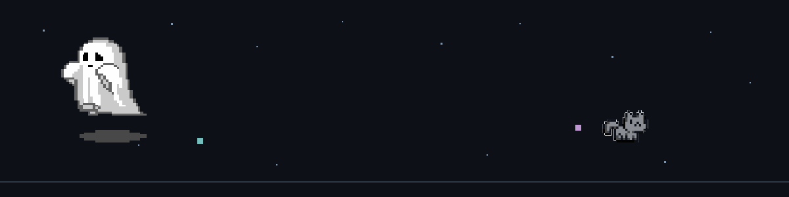

# Hey, I'm Aaradhya 👋

### Developer · Tester · Creative Thinker

*Building things, breaking things, and figuring out how everything works.*

---

## `whoami`

I'm a Computer Science graduate interested in software development, testing, automation, and creative technology.

I enjoy exploring how things work behind the scenes, solving practical problems, and turning ideas into functional projects.

- 🧪 Software testing and debugging
- 💻 Python and web development
- ⚙️ Industrial automation and device integration
- 🗄️ SQL and database management
- 🎨 Pixel art, photography and creative experiments
- 🌱 Currently exploring ESP32 and embedded systems

---

## Tech Stack

  

---

## Things I've Been Building

| Project | Description |
|---|---|
| **Visit Tracker** | A Flask-based application for managing visits, users and follow-up workflows. |
| **Fingerprint Authentication** | Python-based fingerprint authentication integrated with Windows user management and WinCC. |
| **Weighing Scale Integration** | Serial communication, Ethernet-based device connectivity and database integration. |
| **Frontend Experiments** | Creative interfaces, animations and interactive web experiments. |

*Some projects are part of professional or private work and are not publicly available.*

---

## Currently Exploring

- ESP32 and embedded systems
- Hardware and software integration
- Better software testing practices
- Creative frontend development
- Python automation

---

## A Little More About Me

- I like building things just to understand how they work.
- I enjoy experimenting with technology outside my comfort zone.
- I appreciate good design as much as good functionality.
- Sometimes the best way to learn is to break something and fix it.

### Thanks for visiting my little corner of GitHub!

*Stay curious. Keep building. Repeat.*

---

Made with curiosity, coffee, and a questionable number of tabs open.

